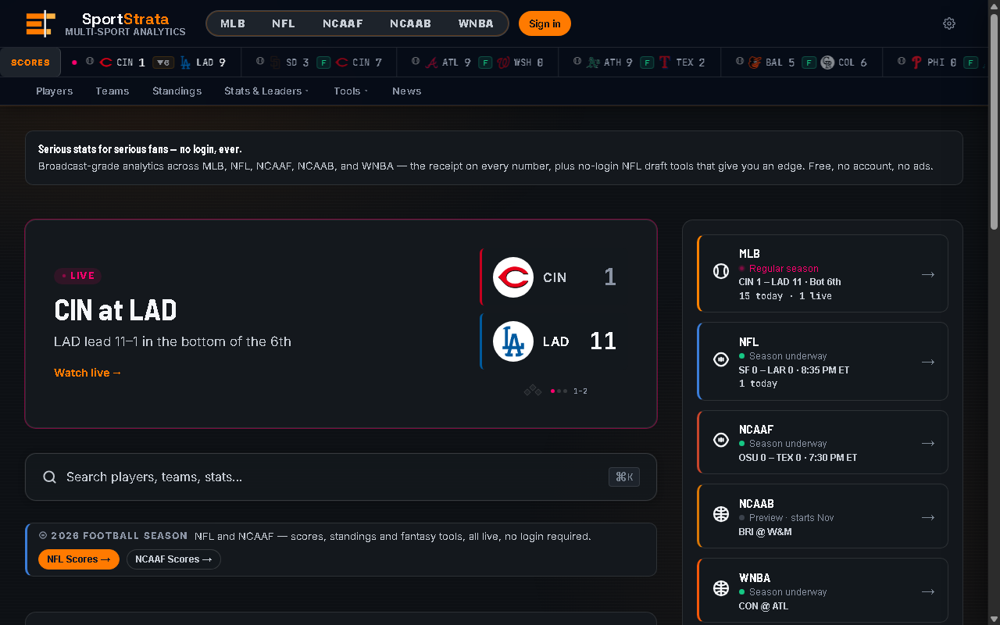

<div align="center">


# SportStrata

### Serious stats for serious fans.

[](https://sportstrata.cc)
[](https://github.com/zohnner/zohn-sports-stats/actions/workflows/ci.yml)
[](https://github.com/zohnner/zohn-sports-stats/actions/workflows/contract-check.yml)


[](https://pages.cloudflare.com/)
[](#license)

**A free sports analytics site, six sports deep:** MLB, NFL, NCAA Football,
NCAA Men's Basketball, NBA and WNBA. One vanilla JavaScript app with
**no framework and no build step**. Every feature works signed-out; an optional
free account only adds cross-device sync. Content pages are edge-rendered on
Cloudflare so search engines and AI crawlers can read them.

**[sportstrata.cc →](https://sportstrata.cc)**

<br>



</div>

---

### Contents

[What it is](#what-it-is) · [Sports](#sports) · [Stories](#sportstrata-stories) ·
[Trust and integrity](#trust-and-integrity) · [SEO](#seo--discoverability) ·
[Tech stack](#tech-stack) · [Getting started](#getting-started) ·
[Project structure](#project-structure) · [Development](#development) ·
[Deployment](#deployment) · [Docs](#docs) · [License](#license)

---

## What it is

Scores, standings, leaders, team and player pages, and live game viewers for
six sports, plus original data stories. No paywall, no ads, no trackers.

Every computed number shows where it came from. That's "the receipt": a
broadcaster or a fantasy player can cite a SportStrata number and know how it
was made.

### At a glance

| Sport | Scores | Standings & teams | Leaders | Team pages | Player pages | Live game viewer | Stories |
|---|:---:|:---:|:---:|:---:|:---:|:---:|:---:|
| ⚾ MLB | ✅ | ✅ | ✅ | ✅ | ✅ | ✅ | ✅ |
| 🏈 NFL | ✅ | ✅ | ✅ | ✅ | ✅ | ✅ | ✅ |
| 🏈 NCAA Football | ✅ | ✅ | ✅ | ✅ | ✅ | ✅ | ✅ |
| 🏀 NCAA Men's Basketball | ✅ | ✅ | ✅ | — | — | ✅ | ✅ |
| 🏀 NBA | ✅ | ✅ | ✅ | ✅ | ✅ | ✅ | ✅ |
| 🏀 WNBA | ✅ | ✅ | ✅ | — | ✅ | ✅ | — |

NHL is parked as a preview and not linked from the site.

---

## Sports

### MLB

The flagship and the deepest surface.

<details>
<summary><b>MLB feature breakdown</b></summary>

- **Players and leaderboards:** hitters and pitchers with computed advanced
  rates (ISO, BABIP, FIP, K-BB%, wOBA, wRC+); Statcast leaderboards (xBA,
  xSLG, xwOBA, EV, Barrel%, HH%, Whiff%, CSW%).
- **Player detail:** Statcast percentile card, pitch arsenal, career table and
  trend chart, splits, spray chart, head-to-head matchups, two-player compare
  with a shareable URL.
- **Game prep (broadcast):** probable pitchers, team comparisons, handedness
  splits, park factor, bullpen tracker, weather, pitcher-vs-team history, and
  a printable sheet (`⌘P`).
- **Live games:** a tabbed viewer (Live, Play-by-Play, Box Score, Matchup,
  Statcast, Bullpen) with win probability replayed from the first pitch, and
  an interactive baseball scorecard with PNG export.
- **Teams and standings:** rosters, schedules, L10 form, run differential,
  magic numbers, power rankings, and **October Odds** (Monte Carlo division
  and playoff odds).
- **Ask bar (⌘K):** plain-language stat queries ("hr leaders", "dodgers ops")
  answered by a deterministic grammar. No model, no inference cost.
- **Stat Builder** for custom formulas, and branded share cards for any stat.

</details>

### NFL

<details>
<summary><b>NFL feature breakdown</b></summary>

- **Scores, standings, teams** live from ESPN, with nflverse (CC-BY-4.0) as a
  fallback for standings, leaders and team pages.
- **Stats:** one sortable table for players and leaders, back to 2000, plus
  Next Gen Stats from 2016.
- **Live game viewer:** the home team's real field, win probability with key
  plays, break cards, play-by-play filters, full team stats, and a pregame
  preview with odds, recent form and fantasy watch.
- **Team pages** with how a team's start compares with every start since 1999.
- **Fantasy:** Draft HQ, a VORP value board, strength of schedule, a no-login
  Mock Draft simulator, injury report, waiver wire, and a Pick'em Confidence
  Helper. A signed-in user can link a Sleeper league.

</details>

### NCAA Football

Scores for every FBS game, AP/Coaches/CFP rankings, conference-grouped
standings and teams, player leaders and detail pages, and a live game viewer
with a field-position graphic.

### NCAA Men's Basketball

Scores for all of Division I, AP/Coaches rankings, conference-grouped
standings and teams, statistical leaders, and the basketball Game Center.
Team and player pages are next.

### NBA

Scores, conference and division standings, team pages, leaders, player pages
with game logs, and the basketball Game Center: a live state strip, shot
chart, Four Factors, scrubbable margin and win-probability charts, and an
on-court box score.

### WNBA

Scores, standings, teams, leaders, player pages, the basketball Game Center,
and a standings-based Playoff Picture.

### Power rankings

Every sport has its own opponent-adjusted rating (iterative SRS with recency
weighting and an early-season prior from last season), not a poll.

---

## SportStrata Stories

Short, original data stories, published daily for NFL, MLB, NCAAF, NBA and
NCAAB. A scheduled agent drafts them from live data. Each story is committed
with a `.facts.json` that sources every number in it, and CI rejects any story
with a number that isn't in that file. Stories never cover injuries, trades,
rumors or quotes.

Stories live at `/<sport>/stories`, on each sport's landing and team pages, and
on the home page.

---

## Trust and integrity

- **Freshness receipts:** live views say when their data was fetched.
- **Contract Check (nightly):** hand-written contracts for each upstream feed
  check the fields the site reads and the counts it expects. Drift opens an
  issue automatically.
- **Route crawl (daily):** clicks game cards and team links on production and
  reports any that land on the wrong page.
- **Integrity audit:** runs every check above, plus tests that plant faults on
  purpose to prove the checks catch them.
- **Source health:** server-side ESPN reads report whether they're live, stale
  or down, and a stale page says so.
- **About & Methodology** at [`/about`](https://sportstrata.cc/about) explains
  the data sources, the models, and how Stories are made.

---

## SEO & discoverability

The app is a hash-routed SPA, but its content is also served at real path URLs
by Cloudflare Pages Functions. Each returns prerendered HTML (title,
description, canonical, JSON-LD and a content snapshot) to every client, then
hands off to the SPA. There's no user-agent sniffing.

- `/` today across every sport, and a landing at `/mlb`, `/nfl`, `/ncaaf`,
  `/ncaab`, `/nba`, `/wnba`
- Standings and leaders for every sport; team, player and game pages where the
  sport has them; `/<sport>/stories`
- Static landings: `/mock-draft`, `/draft-kit`, `/playoff-odds`, `/ask`, `/pickem`
- `sitemap.xml` regenerated daily and whenever a story publishes, plus
  1200×630 Open Graph cards (edge-rendered for stories and MLB players)

---

## Tech stack

| Layer | Choice |
|---|---|
| Frontend | Vanilla JS / HTML / CSS, ES2022+, no framework, no build step |
| Routing | Hash-based SPA plus edge-rendered path URLs |
| Charts | Chart.js 4 and hand-drawn SVG |
| Hosting | Cloudflare Pages and Pages Functions |
| Data | Cloudflare D1 (MLB edge cache, accounts, page-view log) |
| Offline | Service worker (`sw.js`) |
| Automation | GitHub Actions: CI, contract check, route crawl, integrity audit, sitemap, story auto-merge |

### Data sources

- **MLB Stats API** and **Baseball Savant**: MLB scores, stats, Statcast.
- **ESPN public APIs**: NFL, NCAAF, NCAAB, NBA and WNBA scores, standings,
  stats and game data. ESPN blocks Cloudflare's servers, so the browser falls
  back to fetching ESPN directly.
- **nflverse** (CC-BY-4.0): NFL Next Gen Stats, and NFL history since 1999.
- **Sleeper**: NFL players, ADP and trending.
- **Ball Don't Lie**: daily NBA standings backup.
- **Open-Meteo**: game-prep weather.

No secret lives in committed source. Keys go through Cloudflare secrets.

---

## Getting started

No build step. Any static server runs the MLB surface, since the MLB Stats API
is free and keyless:

```bash
npx serve .
```

The other sports read through the `/api/*` Pages Functions, so run those under
Pages:

```bash
npx wrangler pages dev .
```

---

## Project structure

```
/
├── index.html            # SPA shell: script load order, header, CSP meta
├── sw.js                 # service worker (bump CACHE_NAME on every deploy)
├── _headers              # CSP + security headers (mirror index.html's CSP)
├── _routes.json          # which paths reach Pages Functions
├── js/                   # one file per sport (mlb, nfl, ncaaf, ncaab, nba, wnba)
│                         #   plus shared viewers, routing, search, auth, stories
├── css/                  # design tokens (variables.css) and component styles
├── functions/
│   ├── api/              # Pages Functions: upstream proxies, auth, follows, stats
│   ├── mlb/ nfl/ ncaaf/ ncaab/ nba/ wnba/   # edge-rendered pages per sport
│   ├── index.js          # edge-rendered home page
│   └── _*.js             # shared helpers (shell, OG images, ESPN source health, stories)
├── content/<sport>/stories/   # published Stories with their .facts.json
├── tools/                # sitemap, contract check, audits, story checkers, run books
├── tests/                # node --test suites
├── worker/               # standalone Workers (BDL proxy, push alerts, session purge)
├── migrations/           # D1 schema
└── assets/               # icons, fonts, OG cards
```

---

## Development

- **Tests:** `node --test tests/*.test.js` (the same set CI runs).
- **Stories:** `node tools/stories/build-index.cjs --check` validates every story.
- **Before a push:** run the `/deploy-check` routine (manifest sync, CSP
  consistency, theme contrast, tests).
- **A new JS or CSS file** goes in **both** `index.html` and `sw.js`.
- **A new external domain** goes in **both** the CSP `<meta>` in `index.html`
  and `_headers`.
- **A new top-level file or folder** must be classified in
  `functions/_private-paths.cjs`, or CI fails.

---

## Deployment

Cloudflare Pages builds from `main` with no build command and `/` as the
output directory. `functions/` deploys as Pages Functions. D1 bindings (`DB`
for the MLB cache, `USER_DB` for accounts and the page-view log) are set in the
Pages dashboard; see the comment at the top of `wrangler.toml`.

---

## Docs

| File | What it holds |
|---|---|
| [`GOALS.md`](GOALS.md) | What the site is for, rules that never bend, the season calendar and priorities |
| [`CLAUDE.md`](CLAUDE.md) | Architecture and conventions; the instructions every agent follows |
| [`DESIGN.md`](DESIGN.md) | House style |
| [`DECISIONS.md`](DECISIONS.md) | The decision log |
| [`ISSUES.md`](ISSUES.md) | Known bugs and backlog |

---

## License

[MIT](LICENSE)
